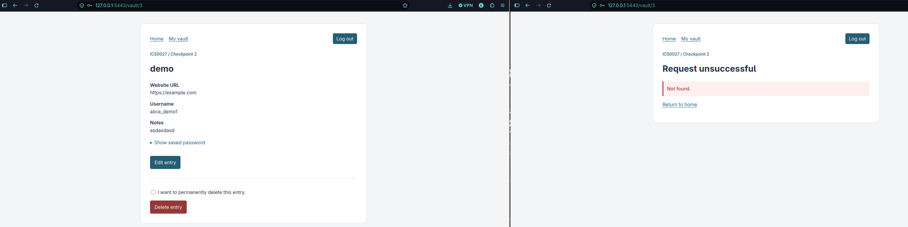
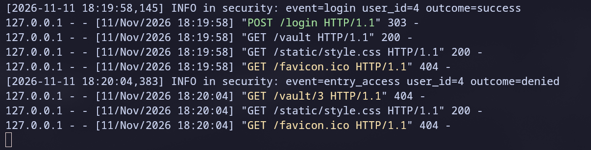
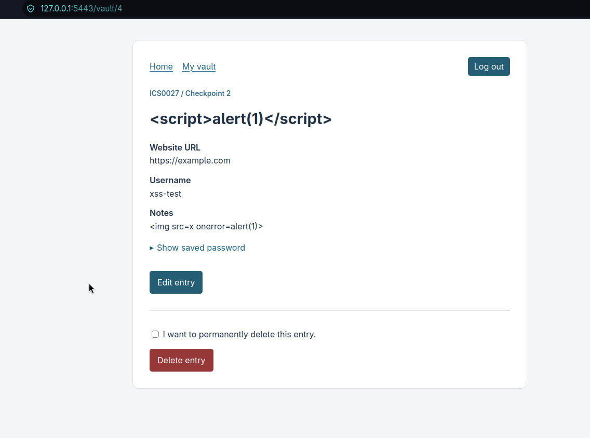
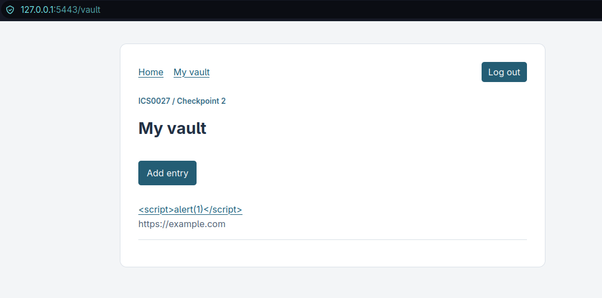
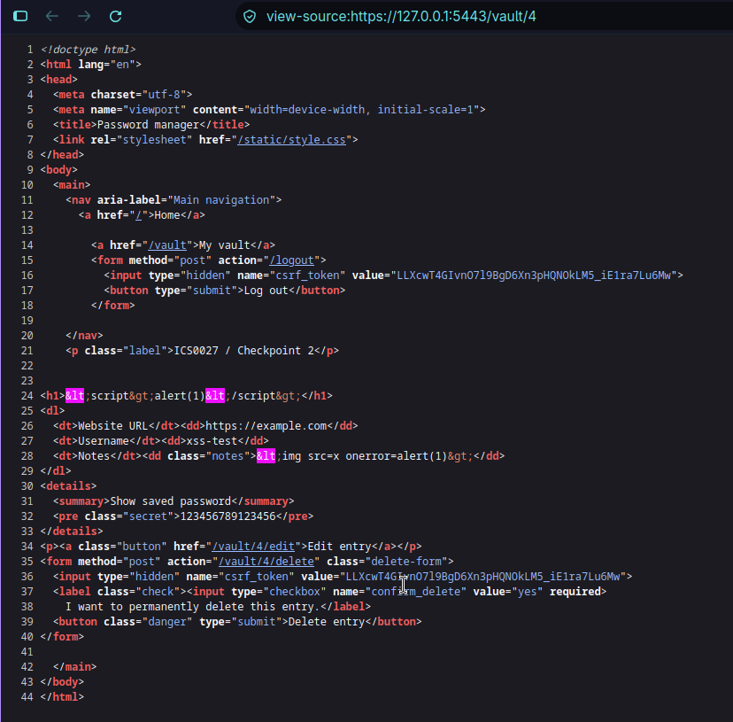
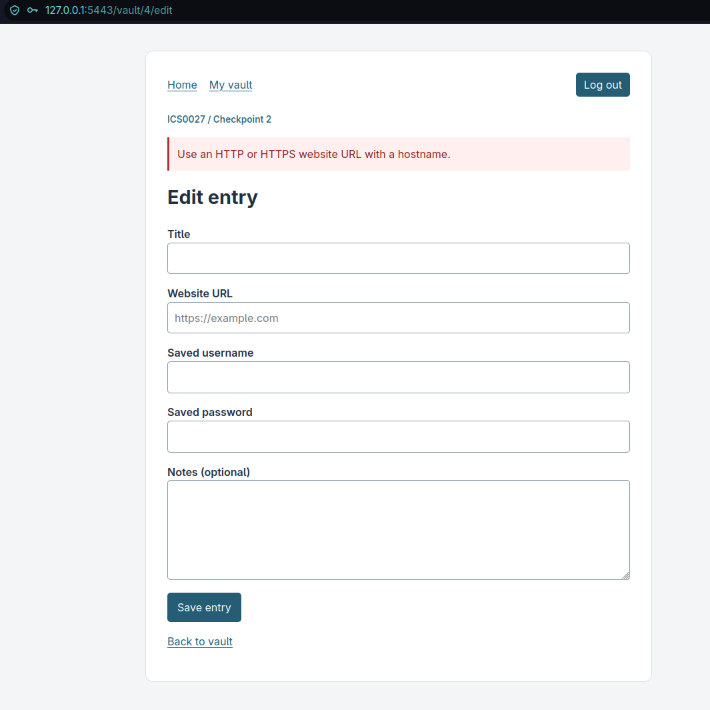
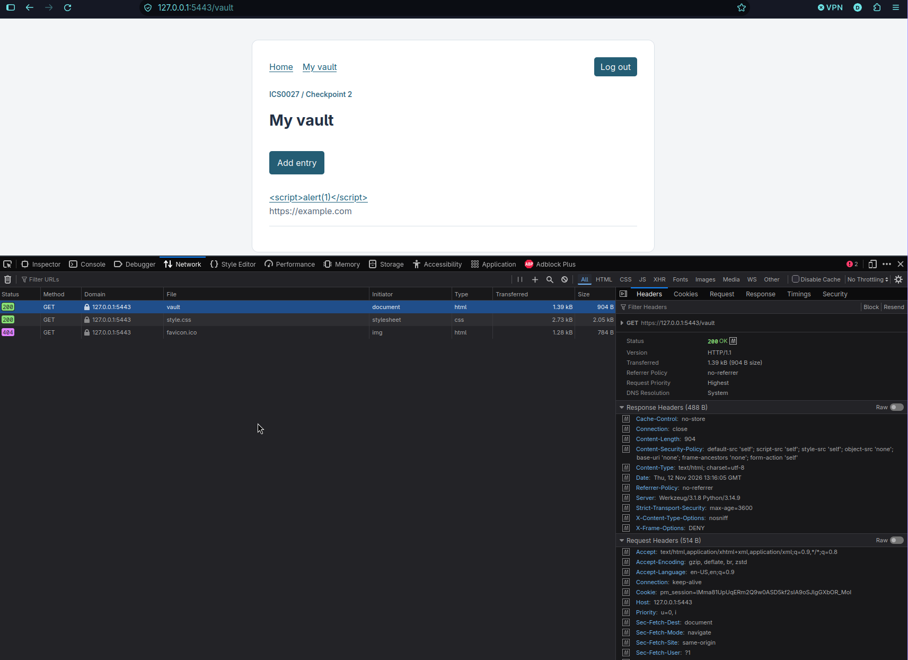

# Security test cases and results

ICS0027 Web Application Security — Web-Based Secure Password Manager, Checkpoint 3.

This document lists the attack vectors that were attempted against the application, the expected and observed results, and the mitigation that stopped each attack. Every automated case has an ID; the matching unit test method starts with the same ID (for example `test_tc_sql_01_...`), so the evidence can be reproduced with one command:

```sh
.venv/bin/python -m unittest discover -s tests -v
```

The automated tests run against a temporary SQLite database with the production Argon2id parameters and an HTTPS base URL. They never touch `instance/vault.sqlite3`. **Pass** means that the attack was blocked and the expected safe behaviour was observed.

## 1 SQL injection (OWASP A05:2025 Injection)

### 1.1 Attack surface

| Input | Does it reach SQL? | Defences |
| --- | --- | --- |
| Login name (register, login) | Yes, as a bound parameter in `find_user` / `create_user` | Allow-list `[a-z0-9_.-]{3,64}` after lowercasing; `?` placeholders |
| Master passphrase | No — it is only passed to Argon2id | Length limits (15–128 characters, ≤ 512 bytes) |
| Entry fields (title, URL, username, password, notes) | No — the JSON payload is encrypted with AES-256-GCM first; SQLite receives a BLOB | Encryption before storage; BLOB bound as a parameter |
| Entry ID in the URL | Yes, as an integer parameter | `<int:entry_id>` route converter; placeholders; owner condition |
| Owner (user ID) | Never taken from the client | Always read from the server-side session |

Every statement lives in `database.py` and uses a constant SQL string with `?` placeholders. The `sqlite3` driver sends the statement and the values separately, so a value can never change the structure of the query.

### 1.2 Payloads

The same ten payloads are used in every SQL injection test (`SQLI_PAYLOADS` in `tests/test_injection_access.py`):

```text
' OR '1'='1
' OR 1=1 --
admin'--
" OR ""="
') OR ('1'='1
'; DROP TABLE users; --
1; DELETE FROM vault_entries --
' UNION SELECT id, login_username, password_hash, kdf_salt, 1, 1, 1, 1 FROM users --
' AND (SELECT COUNT(*) FROM users) > 0 --
%' OR login_username LIKE '%
```

URL payloads: `/vault/1 OR 1=1`, `/vault/1'--`, `/vault/0 UNION SELECT 1`, `/vault/1;DROP TABLE vault_entries`, `/vault/-1`, `/vault/1 OR 1=1/edit` and `/vault/1 OR 1=1/delete`.

### 1.3 Test cases

| ID | Attack vector | Expected result | Result | Mitigation |
| --- | --- | --- | --- | --- |
| TC-SQL-01 | Login bypass: every payload as the login name with the correct master passphrase | 401 with the generic message; no session | Pass | Allow-list validation rejects the name before any query; the query is parameterized anyway |
| TC-SQL-02 | Every payload (padded to 15+ characters) as the master passphrase of an existing account | 401; no session | Pass | The passphrase is never used in SQL, only in Argon2id verification |
| TC-SQL-03 | Every payload as a new login name at registration | 400; no user created; both tables still exist | Pass | Allow-list validation; parameterized `INSERT` |
| TC-SQL-04 | Stored injection: every payload saved in all entry fields | Entry saved; payload shown back literally (HTML-escaped); one user and all tables intact | Pass | Fields are encrypted into a BLOB parameter; Jinja escaping on output |
| TC-SQL-05 | Injection through the entry ID in the URL (GET and POST) | 404; nothing deleted | Pass | `<int:entry_id>` converter rejects non-integers before the view runs |
| TC-SQL-06 | Validation bypassed: payloads passed straight to `find_user`, `find_entry`, `list_entries`, `delete_entry` and `create_user` | No row matched; nothing deleted; a malicious name is stored literally | Pass | `?` placeholders bind values as data |
| TC-SQL-07 | Source audit of every `execute()` / `executescript()` call in the application and tools | All SQL strings are constants; statements with `WHERE`, `VALUES` or `SET` use `?` | Pass | Coding rule enforced by an automated test |
| CP2 regression | `test_sql_payload_is_plain_data_and_auth_is_not_bypassed` (tests/test_web.py) | Payload stored as data; login with `' OR 1=1 --` fails | Pass | As above |

The tests themselves were checked: when `find_user` was temporarily rewritten with an f-string query, TC-SQL-06 and TC-SQL-07 failed; when the owner condition was removed from `find_entry` or `delete_entry`, TC-SQL-06 failed. The vulnerable versions were then reverted.

## 2 Per-user access control (OWASP A01:2025 Broken Access Control)

### 2.1 Mechanism

The user identity comes only from the server-side session record (`g.pm_session.user_id`). `require_login` protects every vault route and logout. `owned_entry()` loads a record with `WHERE id = ? AND user_id = ?` before any read, edit or delete, and the `UPDATE` and `DELETE` statements repeat the owner condition. A foreign entry and a non-existent entry produce the same 404 response, so a user cannot discover which IDs exist. Each denial is written to the audit log as an `entry_access` event with the outcome `denied`. In addition, the AES-GCM associated data contains the owner ID, so a ciphertext moved to another user's row fails authentication.

| Operation | Route | How ownership is enforced |
| --- | --- | --- |
| List | `GET /vault` | `list_entries(user_id)` |
| Create | `POST /vault/new` | Owner is the session user; submitted `user_id` / `owner_id` fields are ignored |
| Read | `GET /vault/<id>` | `find_entry(user_id, id)` |
| Edit form | `GET /vault/<id>/edit` | `find_entry(user_id, id)` |
| Update | `POST /vault/<id>/edit` | `find_entry` + `UPDATE ... WHERE id = ? AND user_id = ?` + AAD |
| Delete | `POST /vault/<id>/delete` | `find_entry` + `DELETE ... WHERE id = ? AND user_id = ?` |
| Logout | `POST /logout` | Requires an authenticated session |

### 2.2 Test cases

| ID | Attack vector | Expected result | Result | Mitigation |
| --- | --- | --- | --- | --- |
| TC-AC-01 | Bob reads Alice's entry by changing the ID in the URL (IDOR) | 404 "Not found." identical to a missing ID; none of Alice's fields in the response; denial logged; Alice can still read it | Pass | Owner-scoped query; uniform 404 |
| TC-AC-02 | Bob opens Alice's edit form, submits an edit and submits a delete (with his own valid CSRF token) | 404 for all three; Alice's entry unchanged | Pass | `owned_entry()` before the operation; owner condition in `UPDATE` / `DELETE` |
| TC-AC-03 | Both users list their vaults | Each list contains only the owner's titles | Pass | `list_entries(user_id)` |
| TC-AC-04 | Bob adds `user_id=1` / `owner_id=1` to the create and edit forms | Entries stay owned by Bob; Alice's entry stays owned by Alice | Pass | Owner never read from the request |
| TC-AC-05 | Anonymous visitor calls every vault route and logout (GET, POST without and with an anonymous CSRF token) | GET → redirect to `/login`; POST → 400 or redirect to `/login`; nothing changed | Pass | `require_login` on every route; CSRF check |
| CP2 regression | `test_second_account_cannot_read_edit_delete_or_forge_owner` (tests/test_web.py) | 404 for foreign read, edit and delete | Pass | As above |
| CP2 regression | `test_tampering_wrong_key_owner_id_and_version_fail` (tests/test_storage.py) | Ciphertext with a changed owner ID cannot be decrypted | Pass | AES-GCM associated data `user_id:entry_id:format_version` |

### 2.3 Manual demonstration: reading another user's vault entry

1.Start the HTTPS server and open <https://localhost:5443/> in a normal browser window. Register `alice-demo` and add an entry. Note its address, for example `https://localhost:5443/vault/1`.
2.Open a private window (separate cookies). Register `bob-demo`.
3.In Bob's window open `https://localhost:5443/vault/1`, then `https://localhost:5443/vault/1/edit`.
4.Expected: "Request unsuccessful — Not found." for both pages, without any of Alice's data. The terminal running the server shows an `entry_access` event with outcome `denied` and Bob's user ID.
5.In Alice's window reload the entry: it is unchanged.

Screenshots for the report: Bob's 404 page with the address bar visible, and the matching log line:

### Screenshot 1 — Bob's access denied response



### Screenshot 2 — Access denied audit log



## 3 Cross-site scripting (OWASP A05:2025 Injection)

### 3.1 Defences

XSS is prevented in layers, so one missing layer does not make the application exploitable:

| Layer | Implementation |
| --- | --- |
| Output encoding | Jinja2 autoescaping is enforced for every template (`app.jinja_env.autoescape = True`), not only for `.html` files. User values appear only in text nodes and quoted attributes. There is no `\|safe`, `Markup`, `render_template_string` or `` |
| Input validation | The website URL must parse as `http`/`https` with a hostname, which rejects `javascript:`, `data:` and `vbscript:` URLs. Field lengths are limited and the login name uses an allow-list. URLs are displayed as text and are never turned into links |
| No reflection | Error messages are fixed strings. Login and registration forms never echo the submitted values, and error pages do not contain the requested path |
| Content Security Policy | `default-src 'self'; script-src 'self'; style-src 'self'; object-src 'none'; base-uri 'none'; frame-ancestors 'none'; form-action 'self'` on every response. Inline scripts, inline event handlers and `javascript:` URLs would be blocked by the browser even if markup were injected |
| No client-side JavaScript | The interface needs no JavaScript, so there are no DOM XSS sinks such as `innerHTML` or `eval` |
| Supporting controls | `HttpOnly` session cookie (a script cannot read it), `X-Content-Type-Options: nosniff`, explicit `charset=utf-8` |

### 3.2 Payloads

```text
<script>alert('xss')</script>
"><script>alert(1)</script>
'>
<svg/onload=alert(1)>
</textarea><script>alert(1)</script>
" autofocus onfocus="alert(1)
<iframe src="javascript:alert(1)"></iframe>
<a href="javascript:alert(1)">click me</a>
<body onload=alert(1)>
<<SCRIPT>alert(1)//<</SCRIPT>
{{ config }}{{ 'ssti' * 3 }}
```

URL payloads: `javascript:alert(document.cookie)`, `JaVaScRiPt:alert(1)`, ` javascript:alert(1)` (leading space), `java<TAB>script:alert(1)`, `javascript://example.test/%0Aalert(document.cookie)`, `data:text/html,<script>alert(1)</script>`, `vbscript:msgbox(1)` and the valid but hostile `https://example.test/"><script>alert(1)</script>`.

### 3.3 Test cases

| ID | Attack vector | Expected result | Result | Mitigation |
| --- | --- | --- | --- | --- |
| TC-XSS-01 | Stored XSS: every payload saved in title, username, password and notes; list, view and edit pages parsed as HTML | Only the template's own elements exist; no event-handler, `autofocus` or `style` attributes; no `javascript:` links; the payload text is shown escaped; the template expression is not evaluated | Pass | Autoescaping in text and quoted attributes |
| TC-XSS-02 | Dangerous URL schemes in the website URL; valid HTTPS URL containing markup | 400 for every dangerous scheme and nothing stored; the hostile HTTPS URL is shown as escaped text, never as a link | Pass | URL allow-list validation; URLs rendered as text |
| TC-XSS-03 | Reflected XSS through the URL path, the login form and both registration fields | 400/401/404 with fixed messages; the payload does not appear in the response at all | Pass | Fixed error messages; no echo of rejected input |
| TC-XSS-04 | Check the CSP on normal pages, the login page and 400/404 error pages | Strict CSP (`script-src 'self'`, `object-src 'none'`, `base-uri 'none'`, `frame-ancestors 'none'`), no `unsafe-inline`/`unsafe-eval`, `nosniff`, UTF-8 | Pass | `security_headers` after-request hook |
| TC-XSS-05 | Source audit of templates, Python modules and static files | No `\|safe`, `Markup`, `render_template_string`, disabled autoescaping, inline `<script>`, `on*=` handlers, `style=` attributes, `javascript:` or `.js` files | Pass | Coding rule enforced by an automated test |
| TC-XSS-06 | Render a template whose name does not end in `.html` | Output is escaped | Pass | `app.jinja_env.autoescape = True` (Checkpoint 3 change; this test failed before it) |
| CP2 regression | `test_xss_escaped_on_list_show_and_edit` (tests/test_web.py) | No `<script>`/`` elements or handler attributes | Pass | As above |
| CP2 regression | `test_cookie_flags_rotation_fixation_and_logout_replay` (tests/test_web.py) | Session cookie is `HttpOnly`, `Secure`, `SameSite=Strict` | Pass | Cookie flags |

The tests were checked by temporarily adding `|safe` to the entry title, disabling autoescaping for the notes field, adding `'unsafe-inline'` to the CSP and allowing the `javascript` scheme in `validation.py`. Each change made at least one of the tests above fail.

### 3.4 Manual demonstration

1.Sign in and add an entry with the title `<script>alert(1)</script>` and the notes ``.
2.Open the entry and the vault list. Expected: the text is shown literally and no alert appears. *View page source* shows `&lt;script&gt;alert(1)&lt;/script&gt;`.
3.Edit the entry and set the website URL to `javascript:alert(1)`. Expected: "Use an HTTP or HTTPS website URL with a hostname." and nothing is saved.
4.In the browser developer tools (*Network* tab) select any page and show the `Content-Security-Policy` response header.

Screenshots documenting the manual verification:

**1. Stored XSS — Entry details**



**2. Stored XSS — Vault list**



**3. HTML escaping — Page source**



**4. Dangerous URL rejection**



**5. Content Security Policy**


